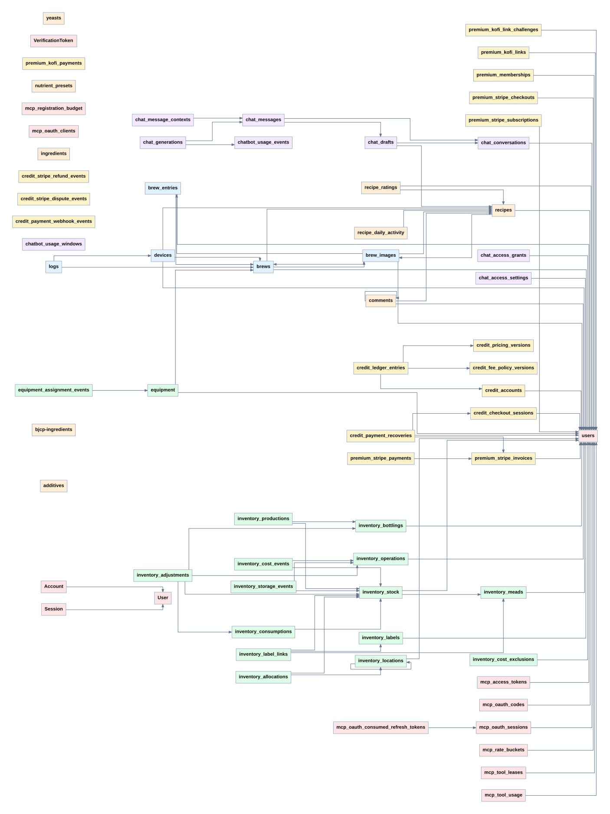

# Database ERD

Generated from `apps/web/prisma/schema.prisma`; regenerate with `npm run db:erd`. Do not edit generated files by hand.

**68 tables · 570 columns · 78 foreign keys · 19 enums.**

Open [the interactive viewer](./erd.html) locally in your browser for search, zoom, pan, and focused areas. It works offline and contains no account or database data.

The SVGs below are directly viewable in the repository and on GitHub:

- [Overview — every table](./overview.svg)
- [Complete schema — every column](./full.svg)
- [Brewing & hydrometers](./brewing.svg)
- [Inventory & equipment](./inventory.svg)
- [Billing & premium](./billing.svg)
- [Chat & model usage](./chat.svg)
- [Identity, authentication & MCP](./identity.svg)
- [Recipes, catalog & community](./recipes.svg)

## Reading the diagrams

- Every Prisma model is present, including unconnected tables and both `users` and the distinct `User` authentication table. Mapped SQL table/column names are shown.
- Full and focused diagrams show columns, native/Prisma types, nullable `?` markers, PK, FK and UK membership. A UK marker can mean part of a compound unique key; consult the dictionary below for its tuple.
- Arrows run from referencing columns to their referenced table. The child end is `0..N` or `0..1`; the parent end is `1` or `0..1`. Minimum child participation is zero: a foreign key does not require a parent to have children.
- Hover over an edge for the complete composite FK and delete/update actions. Focused views include referenced tables as keys-only context; their other outgoing edges are intentionally omitted there.
- Historical IDs, JSON snapshots and polymorphic references without a Prisma relation are columns, not invented FK edges. The ERD describes the checked-in schema, not live database state. SQL-only checks, triggers, RLS and partial/expression indexes must be reviewed in migration SQL; they are outside Prisma's datamodel.

## Schema and migration fingerprints

Schema SHA-256: `81fab8f20ce925b3cb2ce30bbc1e431654318065fb37399b81af45be94b6e99a`

Migration-set SHA-256: `e406a250847fe4a67ef4403a8be933b6e6d494709f31a9e7e2f779ec1a0de6c7`

Both fingerprints are checked by `npm run db:erd:check`; adding or editing a migration requires regenerating these artifacts even when model geometry is unchanged.

## Table index

- [Account](#table-account) — Identity, authentication & MCP
- [additives](#table-additives) — Recipes, catalog & community
- [bjcp-ingredients](#table-bjcpingredient) — Recipes, catalog & community
- [brew_entries](#table-brew_entries) — Brewing & hydrometers
- [brew_images](#table-brew_images) — Brewing & hydrometers
- [brews](#table-brews) — Brewing & hydrometers
- [chat_access_grants](#table-chat_access_grants) — Chat & model usage
- [chat_access_settings](#table-chat_access_settings) — Chat & model usage
- [chat_conversations](#table-chat_conversations) — Chat & model usage
- [chat_drafts](#table-chat_drafts) — Chat & model usage
- [chat_generations](#table-chat_generations) — Chat & model usage
- [chat_message_contexts](#table-chat_message_contexts) — Chat & model usage
- [chat_messages](#table-chat_messages) — Chat & model usage
- [chatbot_usage_events](#table-chatbot_usage_events) — Chat & model usage
- [chatbot_usage_windows](#table-chatbot_usage_windows) — Chat & model usage
- [comments](#table-comments) — Recipes, catalog & community
- [credit_accounts](#table-credit_accounts) — Billing & premium
- [credit_checkout_sessions](#table-credit_checkout_sessions) — Billing & premium
- [credit_fee_policy_versions](#table-credit_fee_policy_versions) — Billing & premium
- [credit_ledger_entries](#table-credit_ledger_entries) — Billing & premium
- [credit_payment_recoveries](#table-credit_payment_recoveries) — Billing & premium
- [credit_payment_webhook_events](#table-credit_payment_webhook_events) — Billing & premium
- [credit_pricing_versions](#table-credit_pricing_versions) — Billing & premium
- [credit_stripe_dispute_events](#table-credit_stripe_dispute_events) — Billing & premium
- [credit_stripe_refund_events](#table-credit_stripe_refund_events) — Billing & premium
- [devices](#table-devices) — Brewing & hydrometers
- [equipment](#table-equipment) — Inventory & equipment
- [equipment_assignment_events](#table-equipment_assignment_events) — Inventory & equipment
- [ingredients](#table-ingredients) — Recipes, catalog & community
- [inventory_adjustments](#table-inventory_adjustments) — Inventory & equipment
- [inventory_allocations](#table-inventory_allocations) — Inventory & equipment
- [inventory_bottlings](#table-inventory_bottlings) — Inventory & equipment
- [inventory_consumptions](#table-inventory_consumptions) — Inventory & equipment
- [inventory_label_links](#table-inventory_label_links) — Inventory & equipment
- [inventory_labels](#table-inventory_labels) — Inventory & equipment
- [inventory_locations](#table-inventory_locations) — Inventory & equipment
- [inventory_meads](#table-inventory_meads) — Inventory & equipment
- [inventory_operations](#table-inventory_operations) — Inventory & equipment
- [inventory_productions](#table-inventory_productions) — Inventory & equipment
- [inventory_stock](#table-inventory_stock) — Inventory & equipment
- [inventory_storage_events](#table-inventory_storage_events) — Inventory & equipment
- [logs](#table-logs) — Brewing & hydrometers
- [mcp_access_tokens](#table-mcp_access_tokens) — Identity, authentication & MCP
- [mcp_oauth_clients](#table-mcp_oauth_clients) — Identity, authentication & MCP
- [mcp_oauth_codes](#table-mcp_oauth_codes) — Identity, authentication & MCP
- [mcp_oauth_consumed_refresh_tokens](#table-mcp_oauth_consumed_refresh_tokens) — Identity, authentication & MCP
- [mcp_oauth_sessions](#table-mcp_oauth_sessions) — Identity, authentication & MCP
- [mcp_rate_buckets](#table-mcp_rate_buckets) — Identity, authentication & MCP
- [mcp_registration_budget](#table-mcp_registration_budget) — Identity, authentication & MCP
- [mcp_tool_leases](#table-mcp_tool_leases) — Identity, authentication & MCP
- [mcp_tool_usage](#table-mcp_tool_usage) — Identity, authentication & MCP
- [nutrient_presets](#table-nutrient_presets) — Recipes, catalog & community
- [premium_kofi_link_challenges](#table-premium_kofi_link_challenges) — Billing & premium
- [premium_kofi_links](#table-premium_kofi_links) — Billing & premium
- [premium_kofi_payments](#table-premium_kofi_payments) — Billing & premium
- [premium_memberships](#table-premium_memberships) — Billing & premium
- [premium_stripe_checkouts](#table-premium_stripe_checkouts) — Billing & premium
- [premium_stripe_invoices](#table-premium_stripe_invoices) — Billing & premium
- [premium_stripe_payments](#table-premium_stripe_payments) — Billing & premium
- [premium_stripe_subscriptions](#table-premium_stripe_subscriptions) — Billing & premium
- [recipe_daily_activity](#table-recipe_daily_activity) — Recipes, catalog & community
- [recipe_ratings](#table-recipe_ratings) — Recipes, catalog & community
- [recipes](#table-recipes) — Recipes, catalog & community
- [Session](#table-session) — Identity, authentication & MCP
- [User](#table-user) — Identity, authentication & MCP
- [users](#table-users) — Identity, authentication & MCP
- [VerificationToken](#table-verificationtoken) — Identity, authentication & MCP
- [yeasts](#table-yeasts) — Recipes, catalog & community

## Data dictionary

### Account

Prisma model: `Account`. Area: Identity, authentication & MCP.

| Column | Type | Keys | Default / behavior |
| --- | --- | --- | --- |
| `id` | `String` | PK | {&quot;name&quot;:&quot;cuid&quot;,&quot;args&quot;:[1]} |
| `userId` | `String` | FK |  |
| `type` | `String` |  |  |
| `provider` | `String` | UK |  |
| `providerAccountId` | `String` | UK |  |
| `refresh_token` | `String?` |  |  |
| `access_token` | `String?` |  |  |
| `expires_at` | `Int?` |  |  |
| `token_type` | `String?` |  |  |
| `scope` | `String?` |  |  |
| `id_token` | `String?` |  |  |
| `session_state` | `String?` |  |  |

Primary key: `id`.

Declared table indexes/constraints:

- `@@unique([provider, providerAccountId])`

Foreign keys:

- (`userId`) → `User` (`id`); delete **Cascade**, update **Cascade (Prisma default)**.

### additives

Prisma model: `additives`. Area: Recipes, catalog & community.

| Column | Type | Keys | Default / behavior |
| --- | --- | --- | --- |
| `id` | `Uuid` | PK | {&quot;name&quot;:&quot;uuid&quot;,&quot;args&quot;:[4]} |
| `created_at` | `Timestamptz(6)` |  | {&quot;name&quot;:&quot;now&quot;,&quot;args&quot;:[]} |
| `name` | `String` |  |  |
| `dosage` | `Float` |  | 0 |
| `unit` | `additive_unit` ([enum](#enum-additive_unit)) |  |  |

Primary key: `id`.

### bjcp-ingredients

Prisma model: `BjcpIngredient`. Area: Recipes, catalog & community.

| Column | Type | Keys | Default / behavior |
| --- | --- | --- | --- |
| `id` | `Uuid` | PK | {&quot;name&quot;:&quot;uuid&quot;,&quot;args&quot;:[4]} |
| `created_at` | `Timestamptz(6)` |  | {&quot;name&quot;:&quot;now&quot;,&quot;args&quot;:[]} |
| `label` | `String?` | UK |  |
| `category` | `String?` |  |  |
| `value` | `String?` | UK |  |

Primary key: `id`.

### brew_entries

Prisma model: `brew_entries`. Area: Brewing & hydrometers.

| Column | Type | Keys | Default / behavior |
| --- | --- | --- | --- |
| `id` | `Uuid` | PK | {&quot;name&quot;:&quot;dbgenerated&quot;,&quot;args&quot;:[&quot;gen_random_uuid()&quot;]} |
| `brew_id` | `Uuid` | FK |  |
| `user_id` | `Int?` | FK |  |
| `datetime` | `Timestamptz(6)` |  | {&quot;name&quot;:&quot;now&quot;,&quot;args&quot;:[]} |
| `type` | `brew_entry_type` ([enum](#enum-brew_entry_type)) |  |  |
| `title` | `String?` |  |  |
| `note` | `Text?` |  |  |
| `gravity` | `Real?` |  |  |
| `temperature` | `Real?` |  |  |
| `temp_units` | `temp_units?` ([enum](#enum-temp_units)) |  |  |
| `data` | `Json?` |  |  |

Primary key: `id`.

Declared table indexes/constraints:

- `@@index([brew_id, datetime])`
- `@@index([brew_id, type])`
- `@@index([user_id, datetime])`

Foreign keys:

- (`brew_id`) → `brews` (`id`); delete **Cascade**, update **Cascade (Prisma default)**.
- (`user_id`) → `users` (`id`); delete **SetNull**, update **Cascade (Prisma default)**.

### brew_images

Prisma model: `brew_images`. Area: Brewing & hydrometers.

Durable upload reservations and cleanup survive brew deletion.

| Column | Type | Keys | Default / behavior |
| --- | --- | --- | --- |
| `id` | `Uuid` | PK |  |
| `brew_id` | `Uuid?` | FK |  |
| `original_brew_id` | `Uuid` |  |  |
| `entry_id` | `Uuid?` | FK |  |
| `original_entry_id` | `Uuid?` |  |  |
| `user_id` | `Int` | FK |  |
| `status` | `VarChar(16)` |  |  |
| `request_hash` | `VarChar(64)` |  |  |
| `image_key` | `String` |  |  |
| `thumbnail_key` | `String` |  |  |
| `caption` | `VarChar(500)` |  | &quot;&quot; |
| `width` | `Int` |  | 0 |
| `height` | `Int` |  | 0 |
| `size_bytes` | `Int` |  | 0 |
| `reserved_bytes` | `Int` |  |  |
| `attempts` | `Int` |  | 1 |
| `removed` | `Boolean` |  | false |
| `cleanup_after` | `Timestamptz(6)` |  |  |
| `created_at` | `Timestamptz(6)` |  | {&quot;name&quot;:&quot;now&quot;,&quot;args&quot;:[]} |
| `updated_at` | `Timestamptz(6)` |  |  @updatedAt |

Primary key: `id`.

Declared table indexes/constraints:

- `@@index([user_id, status])`
- `@@index([brew_id, status])`
- `@@index([entry_id, status])`
- `@@index([status, cleanup_after])`

Foreign keys:

- (`brew_id`) → `brews` (`id`); delete **SetNull**, update **Cascade (Prisma default)**.
- (`entry_id`) → `brew_entries` (`id`); delete **SetNull**, update **Cascade (Prisma default)**.
- (`user_id`) → `users` (`id`); delete **NoAction**, update **Cascade (Prisma default)**.

### brews

Prisma model: `brews`. Area: Brewing & hydrometers.

This model contains row level security and requires additional setup for migrations. Visit https://pris.ly/d/row-level-security for more info.

| Column | Type | Keys | Default / behavior |
| --- | --- | --- | --- |
| `id` | `Uuid` | PK, UK | {&quot;name&quot;:&quot;dbgenerated&quot;,&quot;args&quot;:[&quot;gen_random_uuid()&quot;]} |
| `start_date` | `Timestamptz(6)` |  | {&quot;name&quot;:&quot;now&quot;,&quot;args&quot;:[]} |
| `end_date` | `Timestamptz(6)?` |  |  |
| `user_id` | `Int?` | FK, UK |  |
| `latest_gravity` | `Real?` |  |  |
| `recipe_id` | `Int?` | FK |  |
| `name` | `String?` |  |  |
| `requested_email_alerts` | `Boolean?` |  | false |
| `sb_alert_sent` | `Boolean?` |  | false |
| `fg_alert_sent` | `Boolean?` |  | false |
| `public` | `Boolean` |  | false |
| `stage` | `brew_stage` ([enum](#enum-brew_stage)) |  | &quot;PLANNED&quot; |
| `batch_number` | `Int?` |  |  |
| `current_volume_liters` | `Real?` |  |  |
| `recipe_snapshot` | `Json?` |  |  |
| `gravity_unit_preference` | `gravity_unit` ([enum](#enum-gravity_unit)) |  | &quot;SG&quot; |

Primary key: `id`.

Declared table indexes/constraints:

- `@@unique([id, user_id])`
- `@@index([user_id, start_date])`
- `@@index([recipe_id])`

Foreign keys:

- (`recipe_id`) → `recipes` (`id`); delete **NoAction**, update **NoAction**.
- (`user_id`) → `users` (`id`); delete **NoAction**, update **NoAction**.

### chat_access_grants

Prisma model: `chat_access_grants`. Area: Chat & model usage.

One durable opt-in record per user. Revoking beta access preserves who\ngranted it and when instead of deleting operational history.

| Column | Type | Keys | Default / behavior |
| --- | --- | --- | --- |
| `id` | `Uuid` | PK | {&quot;name&quot;:&quot;dbgenerated&quot;,&quot;args&quot;:[&quot;gen_random_uuid()&quot;]} |
| `user_id` | `Int` | FK, UK |  |
| `granted_at` | `Timestamptz(6)` |  | {&quot;name&quot;:&quot;now&quot;,&quot;args&quot;:[]} |
| `granted_by_user_id` | `Int` |  |  |
| `revoked_at` | `Timestamptz(6)?` |  |  |

Primary key: `id`.

Declared table indexes/constraints:

- `@@index([revoked_at])`

Foreign keys:

- (`user_id`) → `users` (`id`); delete **Restrict**, update **Cascade (Prisma default)**.

### chat_access_settings

Prisma model: `chat_access_settings`. Area: Chat & model usage.

The single rollout policy for private chatbot access. It is intentionally\ndatabase-backed: access controls and beta grants need an auditable source\nof truth even when deployment configuration changes.

| Column | Type | Keys | Default / behavior |
| --- | --- | --- | --- |
| `id` | `Boolean` | PK | true |
| `mode` | `chat_access_mode` ([enum](#enum-chat_access_mode)) |  | &quot;beta_allowlist&quot; |
| `updated_at` | `Timestamptz(6)` |  | {&quot;name&quot;:&quot;now&quot;,&quot;args&quot;:[]} @updatedAt |
| `updated_by_user_id` | `Int?` | FK |  |

Primary key: `id`.

Foreign keys:

- (`updated_by_user_id`) → `users` (`id`); delete **SetNull**, update **Cascade (Prisma default)**.

### chat_conversations

Prisma model: `chat_conversations`. Area: Chat & model usage.

A signed-in user's private chat thread. Transcript content expires after\ninactivity; provider usage has a separate operational retention policy.

| Column | Type | Keys | Default / behavior |
| --- | --- | --- | --- |
| `id` | `Uuid` | PK | {&quot;name&quot;:&quot;dbgenerated&quot;,&quot;args&quot;:[&quot;gen_random_uuid()&quot;]} |
| `user_id` | `Int` | FK |  |
| `title` | `VarChar(160)` |  |  |
| `state` | `chat_conversation_state` ([enum](#enum-chat_conversation_state)) |  | &quot;active&quot; |
| `next_sequence` | `Int` |  | 1 |
| `message_count` | `Int` |  | 0 |
| `content_bytes` | `Int` |  | 0 |
| `last_activity_at` | `Timestamptz(6)` |  | {&quot;name&quot;:&quot;now&quot;,&quot;args&quot;:[]} |
| `expires_at` | `Timestamptz(6)` |  |  |
| `created_at` | `Timestamptz(6)` |  | {&quot;name&quot;:&quot;now&quot;,&quot;args&quot;:[]} |
| `updated_at` | `Timestamptz(6)` |  | {&quot;name&quot;:&quot;now&quot;,&quot;args&quot;:[]} @updatedAt |

Primary key: `id`.

Declared table indexes/constraints:

- `@@index([user_id, state, last_activity_at])`
- `@@index([expires_at])`

Foreign keys:

- (`user_id`) → `users` (`id`); delete **Cascade**, update **Cascade (Prisma default)**.

### chat_drafts

Prisma model: `chat_drafts`. Area: Chat & model usage.

Versioned, validated recipe state for a chat thread. This is not a saved\nMeadTools recipe and is retained/deleted with the conversation.

| Column | Type | Keys | Default / behavior |
| --- | --- | --- | --- |
| `id` | `Uuid` | PK | {&quot;name&quot;:&quot;dbgenerated&quot;,&quot;args&quot;:[&quot;gen_random_uuid()&quot;]} |
| `conversation_id` | `Uuid` | FK, UK |  |
| `revision` | `Int` | UK |  |
| `recipe_draft_input` | `Json?` |  |  |
| `recipe_data` | `Json?` |  |  |
| `saved_recipe_id` | `Int?` | FK |  |
| `created_at` | `Timestamptz(6)` |  | {&quot;name&quot;:&quot;now&quot;,&quot;args&quot;:[]} |

Primary key: `id`.

Declared table indexes/constraints:

- `@@unique([conversation_id, revision])`
- `@@index([conversation_id, created_at])`

Foreign keys:

- (`conversation_id`) → `chat_conversations` (`id`); delete **Cascade**, update **Cascade (Prisma default)**.
- (`saved_recipe_id`) → `recipes` (`id`); delete **SetNull**, update **Cascade (Prisma default)**.

### chat_generations

Prisma model: `chat_generations`. Area: Chat & model usage.

The generation is addressable without retaining a raw provider request.\nUsage lives in chatbot_usage_events and will later be priced by an\neffective-dated provider pricing version.

| Column | Type | Keys | Default / behavior |
| --- | --- | --- | --- |
| `id` | `Uuid` | PK | {&quot;name&quot;:&quot;dbgenerated&quot;,&quot;args&quot;:[&quot;gen_random_uuid()&quot;]} |
| `message_id` | `Uuid` | FK, UK |  |
| `usage_event_id` | `Uuid?` | FK |  |
| `provider` | `VarChar(64)` |  |  |
| `model` | `VarChar(255)` |  |  |
| `status` | `VarChar(16)` |  |  |
| `latency_ms` | `Int?` |  |  |
| `created_at` | `Timestamptz(6)` |  | {&quot;name&quot;:&quot;now&quot;,&quot;args&quot;:[]} |
| `completed_at` | `Timestamptz(6)?` |  |  |

Primary key: `id`.

Declared table indexes/constraints:

- `@@index([usage_event_id])`
- `@@index([provider, model, created_at])`

Foreign keys:

- (`message_id`) → `chat_messages` (`id`); delete **Cascade**, update **Cascade (Prisma default)**.
- (`usage_event_id`) → `chatbot_usage_events` (`id`); delete **SetNull**, update **Cascade (Prisma default)**.

### chat_message_contexts

Prisma model: `chat_message_contexts`. Area: Chat & model usage.

References only the user-selected record identity and display label for a\nturn. These references never implicitly reattach account context later.

| Column | Type | Keys | Default / behavior |
| --- | --- | --- | --- |
| `id` | `Uuid` | PK | {&quot;name&quot;:&quot;dbgenerated&quot;,&quot;args&quot;:[&quot;gen_random_uuid()&quot;]} |
| `message_id` | `Uuid` | FK, UK |  |
| `kind` | `chat_context_kind` ([enum](#enum-chat_context_kind)) | UK |  |
| `record_id` | `VarChar(64)` | UK |  |
| `label` | `VarChar(240)` |  |  |
| `created_at` | `Timestamptz(6)` |  | {&quot;name&quot;:&quot;now&quot;,&quot;args&quot;:[]} |

Primary key: `id`.

Declared table indexes/constraints:

- `@@unique([message_id, kind, record_id])`
- `@@index([record_id, kind])`

Foreign keys:

- (`message_id`) → `chat_messages` (`id`); delete **Cascade**, update **Cascade (Prisma default)**.

### chat_messages

Prisma model: `chat_messages`. Area: Chat & model usage.

Stores only the transcript the user can see. Provider prompts, hidden\nreasoning, and raw tool payloads deliberately do not belong here.

| Column | Type | Keys | Default / behavior |
| --- | --- | --- | --- |
| `id` | `Uuid` | PK | {&quot;name&quot;:&quot;dbgenerated&quot;,&quot;args&quot;:[&quot;gen_random_uuid()&quot;]} |
| `conversation_id` | `Uuid` | FK, UK |  |
| `sequence` | `Int` | UK |  |
| `client_message_id` | `VarChar(128)?` | UK |  |
| `role` | `chat_message_role` ([enum](#enum-chat_message_role)) |  |  |
| `status` | `chat_message_status` ([enum](#enum-chat_message_status)) |  | &quot;pending&quot; |
| `content` | `Text` |  |  |
| `citations` | `JsonB?` |  |  |
| `draft_id` | `Uuid?` | FK |  |
| `created_at` | `Timestamptz(6)` |  | {&quot;name&quot;:&quot;now&quot;,&quot;args&quot;:[]} |
| `completed_at` | `Timestamptz(6)?` |  |  |

Primary key: `id`.

Declared table indexes/constraints:

- `@@unique([conversation_id, sequence])`
- `@@unique([conversation_id, client_message_id])`
- `@@index([conversation_id, created_at])`

Foreign keys:

- (`conversation_id`) → `chat_conversations` (`id`); delete **Cascade**, update **Cascade (Prisma default)**.
- (`draft_id`) → `chat_drafts` (`id`); delete **SetNull**, update **Cascade (Prisma default)**.

### chatbot_usage_events

Prisma model: `chatbot_usage_events`. Area: Chat & model usage.

Stores request metadata and provider usage only; it intentionally never stores chat content.

| Column | Type | Keys | Default / behavior |
| --- | --- | --- | --- |
| `id` | `Uuid` | PK | {&quot;name&quot;:&quot;dbgenerated&quot;,&quot;args&quot;:[&quot;gen_random_uuid()&quot;]} |
| `request_id` | `Uuid` | UK |  |
| `user_id` | `Int` |  |  |
| `environment` | `VarChar(32)` |  |  |
| `model` | `VarChar(255)` |  |  |
| `status` | `VarChar(16)` |  |  |
| `provider_calls` | `Int` |  | 0 |
| `input_tokens` | `Int` |  | 0 |
| `cached_input_tokens` | `Int` |  | 0 |
| `output_tokens` | `Int` |  | 0 |
| `total_tokens` | `Int` |  | 0 |
| `provider_request_ids` | `String[]` |  | [] |
| `provider_attempt_count` | `Int` |  | 0 |
| `created_at` | `Timestamptz(6)` |  | {&quot;name&quot;:&quot;now&quot;,&quot;args&quot;:[]} |
| `completed_at` | `Timestamptz(6)?` |  |  |

Primary key: `id`.

Declared table indexes/constraints:

- `@@index([user_id, created_at])`
- `@@index([created_at, status])`
- `@@index([model, created_at])`
- `@@index([environment, created_at])`
- `@@index([status, created_at])`

### chatbot_usage_windows

Prisma model: `chatbot_usage_windows`. Area: Chat & model usage.

Retains aggregate, non-sensitive provider usage for operational auditing.

| Column | Type | Keys | Default / behavior |
| --- | --- | --- | --- |
| `id` | `Uuid` | PK | {&quot;name&quot;:&quot;dbgenerated&quot;,&quot;args&quot;:[&quot;gen_random_uuid()&quot;]} |
| `user_id` | `Int` | UK |  |
| `window` | `VarChar(8)` | UK |  |
| `window_start` | `Timestamptz(6)` | UK |  |
| `request_count` | `Int` |  | 0 |
| `provider_calls` | `Int` |  | 0 |
| `input_tokens` | `Int` |  | 0 |
| `cached_input_tokens` | `Int` |  | 0 |
| `output_tokens` | `Int` |  | 0 |
| `total_tokens` | `Int` |  | 0 |
| `created_at` | `Timestamptz(6)` |  | {&quot;name&quot;:&quot;now&quot;,&quot;args&quot;:[]} |
| `updated_at` | `Timestamptz(6)` |  | {&quot;name&quot;:&quot;now&quot;,&quot;args&quot;:[]} @updatedAt |

Primary key: `id`.

Declared table indexes/constraints:

- `@@unique([user_id, window, window_start])`
- `@@index([window, window_start])`

### comments

Prisma model: `comments`. Area: Recipes, catalog & community.

| Column | Type | Keys | Default / behavior |
| --- | --- | --- | --- |
| `id` | `Uuid` | PK | {&quot;name&quot;:&quot;uuid&quot;,&quot;args&quot;:[4]} |
| `recipe_id` | `Int` | FK |  |
| `user_id` | `Int` | FK |  |
| `parent_id` | `Uuid?` | FK |  |
| `comment` | `Text` |  |  |
| `created_at` | `Timestamptz(6)` |  | {&quot;name&quot;:&quot;now&quot;,&quot;args&quot;:[]} |
| `updated_at` | `DateTime` |  |  @updatedAt |
| `deleted_at` | `DateTime?` |  |  |

Primary key: `id`.

Declared table indexes/constraints:

- `@@index([recipe_id, created_at])`
- `@@index([parent_id, created_at])`

Foreign keys:

- (`user_id`) → `users` (`id`); delete **Restrict**, update **NoAction**.
- (`parent_id`) → `comments` (`id`); delete **SetNull**, update **Cascade (Prisma default)**.
- (`recipe_id`) → `recipes` (`id`); delete **Cascade**, update **NoAction**.

### credit_accounts

Prisma model: `credit_accounts`. Area: Billing & premium.

A user owns one account. Its available balance is derived from the\nimmutable ledger; do not add a mutable spent or balance column here.

| Column | Type | Keys | Default / behavior |
| --- | --- | --- | --- |
| `id` | `Uuid` | PK | {&quot;name&quot;:&quot;dbgenerated&quot;,&quot;args&quot;:[&quot;gen_random_uuid()&quot;]} |
| `user_id` | `Int` | FK, UK |  |
| `payment_restricted_at` | `Timestamptz(6)?` |  |  |
| `payment_restriction_reason` | `VarChar(255)?` |  |  |
| `payment_restriction_reference` | `VarChar(255)?` |  |  |
| `created_at` | `Timestamptz(6)` |  | {&quot;name&quot;:&quot;now&quot;,&quot;args&quot;:[]} |
| `updated_at` | `Timestamptz(6)` |  | {&quot;name&quot;:&quot;now&quot;,&quot;args&quot;:[]} @updatedAt |

Primary key: `id`.

Declared table indexes/constraints:

- `@@index([payment_restricted_at])`

Foreign keys:

- (`user_id`) → `users` (`id`); delete **Restrict**, update **Cascade (Prisma default)**.

### credit_checkout_sessions

Prisma model: `credit_checkout_sessions`. Area: Billing & premium.

A pending or completed Stripe Checkout session. Payment is credited only\nafter a verified webhook, never from a browser success redirect.

| Column | Type | Keys | Default / behavior |
| --- | --- | --- | --- |
| `id` | `Uuid` | PK | {&quot;name&quot;:&quot;dbgenerated&quot;,&quot;args&quot;:[&quot;gen_random_uuid()&quot;]} |
| `user_id` | `Int` | FK |  |
| `pack_id` | `VarChar(64)` |  |  |
| `credit_amount` | `Int` |  |  |
| `amount_cents` | `Int` |  |  |
| `currency` | `VarChar(3)` |  |  |
| `stripe_checkout_session_id` | `VarChar(255)?` | UK |  |
| `stripe_payment_intent_id` | `VarChar(255)?` | UK |  |
| `stripe_amount_total_cents` | `Int?` |  |  |
| `stripe_payment_currency` | `VarChar(3)?` |  |  |
| `refunded_amount_cents` | `Int` |  | 0 |
| `status` | `credit_checkout_session_status` ([enum](#enum-credit_checkout_session_status)) |  | &quot;pending&quot; |
| `created_at` | `Timestamptz(6)` |  | {&quot;name&quot;:&quot;now&quot;,&quot;args&quot;:[]} |
| `fulfilled_at` | `Timestamptz(6)?` |  |  |
| `refunded_at` | `Timestamptz(6)?` |  |  |

Primary key: `id`.

Declared table indexes/constraints:

- `@@index([user_id, status, created_at])`

Foreign keys:

- (`user_id`) → `users` (`id`); delete **Restrict**, update **Cascade (Prisma default)**.

### credit_fee_policy_versions

Prisma model: `credit_fee_policy_versions`. Area: Billing & premium.

Versioned customer pricing policy. This keeps provider cost, payment fees,\nand MeadTools' margin independently auditable and adjustable over time.

| Column | Type | Keys | Default / behavior |
| --- | --- | --- | --- |
| `id` | `Uuid` | PK | {&quot;name&quot;:&quot;dbgenerated&quot;,&quot;args&quot;:[&quot;gen_random_uuid()&quot;]} |
| `version` | `VarChar(96)` | UK |  |
| `markup_basis_points` | `Int` |  |  |
| `fixed_turn_credits` | `Int` |  | 0 |
| `minimum_turn_credits` | `Int` |  | 1 |
| `effective_at` | `Timestamptz(6)` |  |  |
| `retired_at` | `Timestamptz(6)?` |  |  |
| `created_at` | `Timestamptz(6)` |  | {&quot;name&quot;:&quot;now&quot;,&quot;args&quot;:[]} |

Primary key: `id`.

Declared table indexes/constraints:

- `@@index([effective_at])`

### credit_ledger_entries

Prisma model: `credit_ledger_entries`. Area: Billing & premium.

Append-only financial record for credit purchases, holds, settlement, and\nreversals. A reservation is negative; settlement returns unused credits,\nso the sum of immutable deltas is the final user charge.

| Column | Type | Keys | Default / behavior |
| --- | --- | --- | --- |
| `id` | `Uuid` | PK | {&quot;name&quot;:&quot;dbgenerated&quot;,&quot;args&quot;:[&quot;gen_random_uuid()&quot;]} |
| `account_id` | `Uuid` | FK, UK |  |
| `operation_id` | `Uuid` | UK |  |
| `idempotency_key` | `VarChar(128)` | UK |  |
| `entry_type` | `credit_ledger_entry_type` ([enum](#enum-credit_ledger_entry_type)) | UK |  |
| `credits_delta` | `Int` |  |  |
| `pricing_version_id` | `Uuid?` | FK |  |
| `fee_policy_version_id` | `Uuid?` | FK |  |
| `provider_cost_picousd` | `BigInt?` |  |  |
| `source_amount_cents` | `Int?` |  |  |
| `source_currency` | `VarChar(3)?` |  |  |
| `external_reference` | `VarChar(255)?` |  |  |
| `metadata` | `JsonB?` |  |  |
| `created_at` | `Timestamptz(6)` |  | {&quot;name&quot;:&quot;now&quot;,&quot;args&quot;:[]} |

Primary key: `id`.

Declared table indexes/constraints:

- `@@unique([account_id, idempotency_key])`
- `@@unique([account_id, operation_id, entry_type])`
- `@@index([account_id, created_at])`
- `@@index([entry_type, created_at])`
- `@@index([operation_id])`
- `@@index([external_reference])`

Foreign keys:

- (`account_id`) → `credit_accounts` (`id`); delete **Restrict**, update **Cascade (Prisma default)**.
- (`fee_policy_version_id`) → `credit_fee_policy_versions` (`id`); delete **Restrict**, update **Cascade (Prisma default)**.
- (`pricing_version_id`) → `credit_pricing_versions` (`id`); delete **Restrict**, update **Cascade (Prisma default)**.

### credit_payment_recoveries

Prisma model: `credit_payment_recoveries`. Area: Billing & premium.

A Stripe refund or dispute that affects a credit purchase or premium invoice. The\nprovider amount is retained for audit; the ledger remains the source of\ntruth for credit changes.

| Column | Type | Keys | Default / behavior |
| --- | --- | --- | --- |
| `id` | `Uuid` | PK | {&quot;name&quot;:&quot;dbgenerated&quot;,&quot;args&quot;:[&quot;gen_random_uuid()&quot;]} |
| `checkout_id` | `Uuid?` | FK |  |
| `premium_invoice_id` | `VarChar(255)?` | FK |  |
| `recovery_kind` | `credit_payment_recovery_kind` ([enum](#enum-credit_payment_recovery_kind)) |  |  |
| `status` | `credit_payment_recovery_status` ([enum](#enum-credit_payment_recovery_status)) |  |  |
| `external_reference` | `VarChar(255)` | UK |  |
| `amount_cents` | `Int` |  |  |
| `currency` | `VarChar(3)` |  |  |
| `credit_delta` | `Int?` |  |  |
| `resolution_credit_delta` | `Int?` |  |  |
| `resolution_note` | `Text?` |  |  |
| `resolved_at` | `Timestamptz(6)?` |  |  |
| `resolved_by_user_id` | `Int?` | FK |  |
| `created_at` | `Timestamptz(6)` |  | {&quot;name&quot;:&quot;now&quot;,&quot;args&quot;:[]} |
| `updated_at` | `Timestamptz(6)` |  | {&quot;name&quot;:&quot;now&quot;,&quot;args&quot;:[]} @updatedAt |

Primary key: `id`.

Declared table indexes/constraints:

- `@@index([status, created_at])`
- `@@index([checkout_id])`
- `@@index([premium_invoice_id])`

Foreign keys:

- (`checkout_id`) → `credit_checkout_sessions` (`id`); delete **Restrict**, update **Cascade (Prisma default)**.
- (`premium_invoice_id`) → `premium_stripe_invoices` (`invoice_id`); delete **Restrict**, update **Cascade (Prisma default)**.
- (`resolved_by_user_id`) → `users` (`id`); delete **SetNull**, update **Cascade (Prisma default)**.

### credit_payment_webhook_events

Prisma model: `credit_payment_webhook_events`. Area: Billing & premium.

Deduplicates verified payment provider webhooks. This audit record contains\nevent identity only; Stripe's raw event payload is intentionally not stored.

| Column | Type | Keys | Default / behavior |
| --- | --- | --- | --- |
| `id` | `Uuid` | PK | {&quot;name&quot;:&quot;dbgenerated&quot;,&quot;args&quot;:[&quot;gen_random_uuid()&quot;]} |
| `provider` | `VarChar(32)` |  |  |
| `external_event_id` | `VarChar(255)` | UK |  |
| `event_type` | `VarChar(128)` |  |  |
| `created_at` | `Timestamptz(6)` |  | {&quot;name&quot;:&quot;now&quot;,&quot;args&quot;:[]} |

Primary key: `id`.

### credit_pricing_versions

Prisma model: `credit_pricing_versions`. Area: Billing & premium.

Effective-dated provider prices used to calculate the exact cost of an AI\noperation. Rates are integer picodollars per one million tokens.

| Column | Type | Keys | Default / behavior |
| --- | --- | --- | --- |
| `id` | `Uuid` | PK | {&quot;name&quot;:&quot;dbgenerated&quot;,&quot;args&quot;:[&quot;gen_random_uuid()&quot;]} |
| `provider` | `VarChar(64)` | UK |  |
| `model` | `VarChar(255)` | UK |  |
| `version` | `VarChar(96)` | UK |  |
| `uncached_input_picousd_per_million_tokens` | `BigInt` |  |  |
| `cached_input_picousd_per_million_tokens` | `BigInt` |  |  |
| `output_picousd_per_million_tokens` | `BigInt` |  |  |
| `effective_at` | `Timestamptz(6)` |  |  |
| `retired_at` | `Timestamptz(6)?` |  |  |
| `created_at` | `Timestamptz(6)` |  | {&quot;name&quot;:&quot;now&quot;,&quot;args&quot;:[]} |

Primary key: `id`.

Declared table indexes/constraints:

- `@@unique([provider, model, version])`
- `@@index([provider, model, effective_at])`

### credit_stripe_dispute_events

Prisma model: `credit_stripe_dispute_events`. Area: Billing & premium.

Retains the minimal non-sensitive fields required to finish a dispute\nrecovery that reaches us before its Checkout fulfillment webhook.

| Column | Type | Keys | Default / behavior |
| --- | --- | --- | --- |
| `id` | `Uuid` | PK | {&quot;name&quot;:&quot;dbgenerated&quot;,&quot;args&quot;:[&quot;gen_random_uuid()&quot;]} |
| `external_event_id` | `VarChar(255)` | UK |  |
| `event_type` | `VarChar(128)` |  |  |
| `stripe_dispute_id` | `VarChar(255)` |  |  |
| `stripe_payment_intent_id` | `VarChar(255)` |  |  |
| `amount_cents` | `Int` |  |  |
| `currency` | `VarChar(3)` |  |  |
| `status` | `credit_stripe_dispute_event_status` ([enum](#enum-credit_stripe_dispute_event_status)) |  | &quot;deferred&quot; |
| `created_at` | `Timestamptz(6)` |  | {&quot;name&quot;:&quot;now&quot;,&quot;args&quot;:[]} |
| `processed_at` | `Timestamptz(6)?` |  |  |

Primary key: `id`.

Declared table indexes/constraints:

- `@@index([stripe_payment_intent_id, status])`
- `@@index([stripe_dispute_id])`

### credit_stripe_refund_events

Prisma model: `credit_stripe_refund_events`. Area: Billing & premium.

Retains the minimal verified fields required to replay a succeeded refund\nthat arrives before its Checkout fulfillment webhook.

| Column | Type | Keys | Default / behavior |
| --- | --- | --- | --- |
| `id` | `Uuid` | PK | {&quot;name&quot;:&quot;dbgenerated&quot;,&quot;args&quot;:[&quot;gen_random_uuid()&quot;]} |
| `external_event_id` | `VarChar(255)` | UK |  |
| `event_type` | `VarChar(128)` |  |  |
| `stripe_refund_id` | `VarChar(255)` |  |  |
| `stripe_payment_intent_id` | `VarChar(255)` |  |  |
| `amount_cents` | `Int` |  |  |
| `currency` | `VarChar(3)` |  |  |
| `status` | `credit_stripe_refund_event_status` ([enum](#enum-credit_stripe_refund_event_status)) |  | &quot;deferred&quot; |
| `created_at` | `Timestamptz(6)` |  | {&quot;name&quot;:&quot;now&quot;,&quot;args&quot;:[]} |
| `processed_at` | `Timestamptz(6)?` |  |  |

Primary key: `id`.

Declared table indexes/constraints:

- `@@index([stripe_payment_intent_id, status])`
- `@@index([stripe_refund_id])`

### devices

Prisma model: `devices`. Area: Brewing & hydrometers.

This model contains row level security and requires additional setup for migrations. Visit https://pris.ly/d/row-level-security for more info.

| Column | Type | Keys | Default / behavior |
| --- | --- | --- | --- |
| `id` | `Uuid` | PK | {&quot;name&quot;:&quot;dbgenerated&quot;,&quot;args&quot;:[&quot;gen_random_uuid()&quot;]} |
| `device_name` | `String?` |  |  |
| `recipe_id` | `Int?` | FK |  |
| `user_id` | `Int` | FK |  |
| `coefficients` | `Real[]` |  | [] |
| `brew_id` | `Uuid?` | FK |  |

Primary key: `id`.

Foreign keys:

- (`brew_id`) → `brews` (`id`); delete **NoAction**, update **NoAction**.
- (`recipe_id`) → `recipes` (`id`); delete **NoAction**, update **NoAction**.
- (`user_id`) → `users` (`id`); delete **NoAction**, update **NoAction**.

### equipment

Prisma model: `equipment`. Area: Inventory & equipment.

| Column | Type | Keys | Default / behavior |
| --- | --- | --- | --- |
| `group_id` | `Uuid` |  | {&quot;name&quot;:&quot;dbgenerated&quot;,&quot;args&quot;:[&quot;gen_random_uuid()&quot;]} |
| `label` | `VarChar(100)?` |  |  |
| `id` | `Uuid` | PK, UK | {&quot;name&quot;:&quot;dbgenerated&quot;,&quot;args&quot;:[&quot;gen_random_uuid()&quot;]} |
| `user_id` | `Int` | FK, UK |  |
| `name` | `VarChar(200)` |  |  |
| `type` | `equipment_type` ([enum](#enum-equipment_type)) |  |  |
| `capacity` | `Decimal(16,6)?` |  |  |
| `capacity_unit` | `inventory_quantity_unit?` ([enum](#enum-inventory_quantity_unit)) |  |  |
| `notes` | `VarChar(5000)?` |  |  |
| `current_brew_id` | `Uuid?` | FK |  |
| `archived_at` | `Timestamptz(6)?` |  |  |
| `created_at` | `Timestamptz(6)` |  | {&quot;name&quot;:&quot;now&quot;,&quot;args&quot;:[]} |
| `updated_at` | `Timestamptz(6)` |  | {&quot;name&quot;:&quot;now&quot;,&quot;args&quot;:[]} @updatedAt |

Primary key: `id`.

Declared table indexes/constraints:

- `@@unique([id, user_id])`
- `@@index([user_id, archived_at])`
- `@@index([current_brew_id, user_id])`
- `@@index([user_id, group_id])`

Foreign keys:

- (`current_brew_id`, `user_id`) → `brews` (`id`, `user_id`); delete **NoAction**, update **Restrict**.
- (`user_id`) → `users` (`id`); delete **Restrict**, update **Cascade (Prisma default)**.

### equipment_assignment_events

Prisma model: `equipment_assignment_events`. Area: Inventory & equipment.

Historical brew IDs survive deletion; one event per retried assignment request.

| Column | Type | Keys | Default / behavior |
| --- | --- | --- | --- |
| `id` | `Uuid` | PK | {&quot;name&quot;:&quot;dbgenerated&quot;,&quot;args&quot;:[&quot;gen_random_uuid()&quot;]} |
| `user_id` | `Int` | FK, UK |  |
| `equipment_id` | `Uuid` | FK, UK |  |
| `operation_key` | `Uuid` | UK |  |
| `from_brew_id` | `Uuid?` |  |  |
| `to_brew_id` | `Uuid?` |  |  |
| `created_at` | `Timestamptz(6)` |  | {&quot;name&quot;:&quot;now&quot;,&quot;args&quot;:[]} |

Primary key: `id`.

Declared table indexes/constraints:

- `@@unique([user_id, operation_key, equipment_id])`
- `@@index([user_id, equipment_id, created_at])`

Foreign keys:

- (`equipment_id`, `user_id`) → `equipment` (`id`, `user_id`); delete **Restrict**, update **Restrict**.

### ingredients

Prisma model: `ingredients`. Area: Recipes, catalog & community.

| Column | Type | Keys | Default / behavior |
| --- | --- | --- | --- |
| `id` | `Int` | PK | {&quot;name&quot;:&quot;autoincrement&quot;,&quot;args&quot;:[]} |
| `name` | `VarChar(255)` |  |  |
| `sugar_content` | `Decimal` |  |  |
| `water_content` | `Decimal` |  |  |
| `category` | `VarChar(255)` |  |  |

Primary key: `id`.

### inventory_adjustments

Prisma model: `inventory_adjustments`. Area: Inventory & equipment.

Append-only audit rows; write with balance, operation and consumption in one transaction.

| Column | Type | Keys | Default / behavior |
| --- | --- | --- | --- |
| `id` | `Uuid` | PK | {&quot;name&quot;:&quot;dbgenerated&quot;,&quot;args&quot;:[&quot;gen_random_uuid()&quot;]} |
| `user_id` | `Int` | FK |  |
| `stock_id` | `Uuid` | FK, UK |  |
| `operation_id` | `Uuid` | FK, UK |  |
| `consumption_id` | `Uuid?` | FK |  |
| `bottling_id` | `Uuid?` | FK |  |
| `kind` | `VarChar(32)` |  |  |
| `delta` | `Decimal(16,6)` |  |  |
| `balance_after` | `Decimal(16,6)` |  |  |
| `unit` | `inventory_quantity_unit` ([enum](#enum-inventory_quantity_unit)) | FK |  |
| `note` | `VarChar(5000)?` |  |  |
| `created_at` | `Timestamptz(6)` |  | {&quot;name&quot;:&quot;now&quot;,&quot;args&quot;:[]} |

Primary key: `id`.

Declared table indexes/constraints:

- `@@index([bottling_id])`
- `@@unique([operation_id, stock_id])`
- `@@index([user_id, stock_id, created_at])`
- `@@index([consumption_id])`

Foreign keys:

- (`bottling_id`, `user_id`) → `inventory_bottlings` (`id`, `user_id`); delete **Restrict**, update **Restrict**.
- (`consumption_id`, `user_id`) → `inventory_consumptions` (`id`, `user_id`); delete **Restrict**, update **Restrict**.
- (`operation_id`, `user_id`) → `inventory_operations` (`id`, `user_id`); delete **Restrict**, update **Restrict**.
- (`stock_id`, `user_id`, `unit`) → `inventory_stock` (`id`, `user_id`, `unit`); delete **Restrict**, update **Restrict**.

### inventory_allocations

Prisma model: `inventory_allocations`. Area: Inventory & equipment.

| Column | Type | Keys | Default / behavior |
| --- | --- | --- | --- |
| `id` | `Uuid` | PK | {&quot;name&quot;:&quot;dbgenerated&quot;,&quot;args&quot;:[&quot;gen_random_uuid()&quot;]} |
| `user_id` | `Int` | FK |  |
| `stock_id` | `Uuid` | FK, UK |  |
| `unit` | `inventory_quantity_unit` ([enum](#enum-inventory_quantity_unit)) | FK |  |
| `location_id` | `Uuid` | FK, UK |  |
| `position` | `VarChar(200)` | UK | &quot;&quot; |
| `quantity` | `Decimal(16,6)` |  |  |

Primary key: `id`.

Declared table indexes/constraints:

- `@@unique([stock_id, location_id, position])`
- `@@index([user_id, location_id])`

Foreign keys:

- (`location_id`, `user_id`) → `inventory_locations` (`id`, `user_id`); delete **Restrict**, update **Restrict**.
- (`stock_id`, `user_id`, `unit`) → `inventory_stock` (`id`, `user_id`, `unit`); delete **Restrict**, update **Restrict**.

### inventory_bottlings

Prisma model: `inventory_bottlings`. Area: Inventory & equipment.

Private production provenance survives source entry/brew deletion.\nSource IDs deliberately have no cascading FK; source_snapshot retains context.

| Column | Type | Keys | Default / behavior |
| --- | --- | --- | --- |
| `id` | `Uuid` | PK, UK | {&quot;name&quot;:&quot;dbgenerated&quot;,&quot;args&quot;:[&quot;gen_random_uuid()&quot;]} |
| `user_id` | `Int` | FK, UK |  |
| `brew_id` | `Uuid` |  |  |
| `entry_id` | `Uuid` | UK |  |
| `source_name` | `VarChar(200)` |  |  |
| `source_snapshot` | `Json` |  |  |
| `version` | `Int` |  | 0 |
| `reconciliation_required` | `Boolean` |  | false |
| `removed_at` | `Timestamptz(6)?` |  |  |

Primary key: `id`.

Declared table indexes/constraints:

- `@@unique([id, user_id])`
- `@@index([user_id, brew_id])`

Foreign keys:

- (`user_id`) → `users` (`id`); delete **Restrict**, update **Cascade (Prisma default)**.

### inventory_consumptions

Prisma model: `inventory_consumptions`. Area: Inventory & equipment.

Retain the physical-use identity and deduction after entry/brew deletion.\nBrew and entry IDs are historical snapshots, deliberately not cascading FKs.

| Column | Type | Keys | Default / behavior |
| --- | --- | --- | --- |
| `line_key` | `VarChar(200)` | UK | &quot;addition&quot; |
| `id` | `Uuid` | PK, UK | {&quot;name&quot;:&quot;dbgenerated&quot;,&quot;args&quot;:[&quot;gen_random_uuid()&quot;]} |
| `user_id` | `Int` | FK, UK |  |
| `stock_id` | `Uuid` | FK |  |
| `brew_id` | `Uuid` |  |  |
| `entry_id` | `Uuid` | UK |  |
| `use_key` | `Uuid` | UK |  |
| `deducted` | `Decimal(16,6)` |  |  |
| `unit` | `inventory_quantity_unit` ([enum](#enum-inventory_quantity_unit)) | FK |  |
| `reversed_at` | `Timestamptz(6)?` |  |  |
| `created_at` | `Timestamptz(6)` |  | {&quot;name&quot;:&quot;now&quot;,&quot;args&quot;:[]} |
| `updated_at` | `Timestamptz(6)` |  | {&quot;name&quot;:&quot;now&quot;,&quot;args&quot;:[]} @updatedAt |

Primary key: `id`.

Declared table indexes/constraints:

- `@@unique([user_id, use_key])`
- `@@unique([user_id, entry_id, line_key])`
- `@@unique([id, user_id])`
- `@@index([user_id, brew_id, entry_id])`

Foreign keys:

- (`stock_id`, `user_id`, `unit`) → `inventory_stock` (`id`, `user_id`, `unit`); delete **Restrict**, update **Restrict**.

### inventory_label_links

Prisma model: `inventory_label_links`. Area: Inventory & equipment.

| Column | Type | Keys | Default / behavior |
| --- | --- | --- | --- |
| `id` | `Uuid` | PK | {&quot;name&quot;:&quot;dbgenerated&quot;,&quot;args&quot;:[&quot;gen_random_uuid()&quot;]} |
| `user_id` | `Int` | FK |  |
| `label_id` | `Uuid` | FK, UK |  |
| `stock_id` | `Uuid?` | FK, UK |  |
| `mead_id` | `Uuid?` | FK, UK |  |

Primary key: `id`.

Declared table indexes/constraints:

- `@@unique([label_id, stock_id])`
- `@@unique([label_id, mead_id])`
- `@@index([user_id])`

Foreign keys:

- (`label_id`, `user_id`) → `inventory_labels` (`id`, `user_id`); delete **Restrict**, update **Restrict**.
- (`mead_id`, `user_id`) → `inventory_meads` (`id`, `user_id`); delete **Restrict**, update **Restrict**.
- (`stock_id`, `user_id`) → `inventory_stock` (`id`, `user_id`); delete **Restrict**, update **Restrict**.

### inventory_labels

Prisma model: `inventory_labels`. Area: Inventory & equipment.

| Column | Type | Keys | Default / behavior |
| --- | --- | --- | --- |
| `id` | `Uuid` | PK, UK | {&quot;name&quot;:&quot;dbgenerated&quot;,&quot;args&quot;:[&quot;gen_random_uuid()&quot;]} |
| `user_id` | `Int` | FK, UK |  |
| `name` | `VarChar(100)` |  |  |
| `version` | `Int` |  | 0 |
| `archived_at` | `Timestamptz(6)?` |  |  |

Primary key: `id`.

Declared table indexes/constraints:

- `@@unique([id, user_id])`
- `@@index([user_id, archived_at])`

Foreign keys:

- (`user_id`) → `users` (`id`); delete **Restrict**, update **Cascade (Prisma default)**.

### inventory_locations

Prisma model: `inventory_locations`. Area: Inventory & equipment.

| Column | Type | Keys | Default / behavior |
| --- | --- | --- | --- |
| `id` | `Uuid` | PK, UK | {&quot;name&quot;:&quot;dbgenerated&quot;,&quot;args&quot;:[&quot;gen_random_uuid()&quot;]} |
| `user_id` | `Int` | FK, UK |  |
| `name` | `VarChar(100)` |  |  |
| `parent_id` | `Uuid?` | FK |  |
| `version` | `Int` |  | 0 |
| `archived_at` | `Timestamptz(6)?` |  |  |

Primary key: `id`.

Declared table indexes/constraints:

- `@@unique([id, user_id])`
- `@@index([user_id, archived_at])`

Foreign keys:

- (`parent_id`, `user_id`) → `inventory_locations` (`id`, `user_id`); delete **Restrict**, update **Restrict**.
- (`user_id`) → `users` (`id`); delete **Restrict**, update **Cascade (Prisma default)**.

### inventory_meads

Prisma model: `inventory_meads`. Area: Inventory & equipment.

User-defined finished-mead entry. A single entry may contain several bottle\nsizes and receive stock from multiple bottlings; it is not a required lot.

| Column | Type | Keys | Default / behavior |
| --- | --- | --- | --- |
| `id` | `Uuid` | PK, UK | {&quot;name&quot;:&quot;dbgenerated&quot;,&quot;args&quot;:[&quot;gen_random_uuid()&quot;]} |
| `user_id` | `Int` | FK, UK |  |
| `name` | `VarChar(200)` |  |  |
| `notes` | `VarChar(5000)?` |  |  |
| `version` | `Int` |  | 0 |
| `archived_at` | `Timestamptz(6)?` |  |  |
| `created_at` | `Timestamptz(6)` |  | {&quot;name&quot;:&quot;now&quot;,&quot;args&quot;:[]} |
| `updated_at` | `Timestamptz(6)` |  | {&quot;name&quot;:&quot;now&quot;,&quot;args&quot;:[]} @updatedAt |

Primary key: `id`.

Declared table indexes/constraints:

- `@@unique([id, user_id])`
- `@@index([user_id, archived_at])`

Foreign keys:

- (`user_id`) → `users` (`id`); delete **Restrict**, update **Cascade (Prisma default)**.

### inventory_operations

Prisma model: `inventory_operations`. Area: Inventory & equipment.

One request identity per account, including a saved response for retries.

| Column | Type | Keys | Default / behavior |
| --- | --- | --- | --- |
| `id` | `Uuid` | PK, UK | {&quot;name&quot;:&quot;dbgenerated&quot;,&quot;args&quot;:[&quot;gen_random_uuid()&quot;]} |
| `user_id` | `Int` | FK, UK |  |
| `operation_key` | `Uuid` | UK |  |
| `request_hash` | `VarChar(64)` |  |  |
| `result` | `Json` |  |  |
| `created_at` | `Timestamptz(6)` |  | {&quot;name&quot;:&quot;now&quot;,&quot;args&quot;:[]} |

Primary key: `id`.

Declared table indexes/constraints:

- `@@unique([user_id, operation_key])`
- `@@unique([id, user_id])`

Foreign keys:

- (`user_id`) → `users` (`id`); delete **Restrict**, update **Cascade (Prisma default)**.

### inventory_productions

Prisma model: `inventory_productions`. Area: Inventory & equipment.

| Column | Type | Keys | Default / behavior |
| --- | --- | --- | --- |
| `id` | `Uuid` | PK | {&quot;name&quot;:&quot;dbgenerated&quot;,&quot;args&quot;:[&quot;gen_random_uuid()&quot;]} |
| `user_id` | `Int` | FK |  |
| `bottling_id` | `Uuid` | FK, UK |  |
| `stock_id` | `Uuid` | FK, UK |  |
| `row_id` | `Uuid` | UK |  |
| `quantity` | `Int` |  |  |

Primary key: `id`.

Declared table indexes/constraints:

- `@@unique([bottling_id, row_id, stock_id])`
- `@@index([user_id, stock_id])`

Foreign keys:

- (`bottling_id`, `user_id`) → `inventory_bottlings` (`id`, `user_id`); delete **Restrict**, update **Restrict**.
- (`stock_id`, `user_id`) → `inventory_stock` (`id`, `user_id`); delete **Restrict**, update **Restrict**.

### inventory_stock

Prisma model: `inventory_stock`. Area: Inventory & equipment.

Archive referenced stock; preserve quantities and audit records after expiry.

| Column | Type | Keys | Default / behavior |
| --- | --- | --- | --- |
| `id` | `Uuid` | PK, UK | {&quot;name&quot;:&quot;dbgenerated&quot;,&quot;args&quot;:[&quot;gen_random_uuid()&quot;]} |
| `user_id` | `Int` | FK, UK |  |
| `name` | `VarChar(200)` |  |  |
| `category` | `inventory_stock_category` ([enum](#enum-inventory_stock_category)) |  |  |
| `catalog` | `VarChar(32)?` |  |  |
| `catalog_id` | `VarChar(200)?` |  |  |
| `quantity` | `Decimal(16,6)` |  |  |
| `unit` | `inventory_quantity_unit` ([enum](#enum-inventory_quantity_unit)) | UK |  |
| `notes` | `VarChar(5000)?` |  |  |
| `archived_at` | `Timestamptz(6)?` |  |  |
| `reconciliation_required` | `Boolean` |  | false |
| `created_at` | `Timestamptz(6)` |  | {&quot;name&quot;:&quot;now&quot;,&quot;args&quot;:[]} |
| `updated_at` | `Timestamptz(6)` |  | {&quot;name&quot;:&quot;now&quot;,&quot;args&quot;:[]} @updatedAt |
| `mead_id` | `Uuid?` | FK, UK |  |
| `bottle_size_liters` | `Decimal(16,6)?` | UK |  |
| `bottle_size_value` | `Decimal(16,6)?` |  |  |
| `bottle_size_unit` | `inventory_quantity_unit?` ([enum](#enum-inventory_quantity_unit)) |  |  |
| `storage_version` | `Int` |  | 0 |

Primary key: `id`.

Declared table indexes/constraints:

- `@@unique([id, user_id, unit])`
- `@@unique([id, user_id])`
- `@@index([user_id, archived_at])`
- `@@index([user_id, catalog, catalog_id])`
- `@@unique([mead_id, bottle_size_liters])`

Foreign keys:

- (`mead_id`, `user_id`) → `inventory_meads` (`id`, `user_id`); delete **Restrict**, update **Restrict**.
- (`user_id`) → `users` (`id`); delete **Restrict**, update **Cascade (Prisma default)**.

### inventory_storage_events

Prisma model: `inventory_storage_events`. Area: Inventory & equipment.

| Column | Type | Keys | Default / behavior |
| --- | --- | --- | --- |
| `id` | `Uuid` | PK | {&quot;name&quot;:&quot;dbgenerated&quot;,&quot;args&quot;:[&quot;gen_random_uuid()&quot;]} |
| `user_id` | `Int` | FK |  |
| `stock_id` | `Uuid` | FK |  |
| `unit` | `inventory_quantity_unit` ([enum](#enum-inventory_quantity_unit)) | FK |  |
| `operation_id` | `Uuid` | FK |  |
| `location_path` | `VarChar(5000)` |  |  |
| `position` | `VarChar(200)` |  |  |
| `delta` | `Decimal(16,6)` |  |  |
| `balance_after` | `Decimal(16,6)` |  |  |
| `reason` | `VarChar(32)` |  |  |
| `created_at` | `Timestamptz(6)` |  | {&quot;name&quot;:&quot;now&quot;,&quot;args&quot;:[]} |

Primary key: `id`.

Declared table indexes/constraints:

- `@@index([user_id, stock_id, created_at])`

Foreign keys:

- (`operation_id`, `user_id`) → `inventory_operations` (`id`, `user_id`); delete **Restrict**, update **Restrict**.
- (`stock_id`, `user_id`, `unit`) → `inventory_stock` (`id`, `user_id`, `unit`); delete **Restrict**, update **Restrict**.

### logs

Prisma model: `logs`. Area: Brewing & hydrometers.

This model contains row level security and requires additional setup for migrations. Visit https://pris.ly/d/row-level-security for more info.

| Column | Type | Keys | Default / behavior |
| --- | --- | --- | --- |
| `id` | `Uuid` | PK | {&quot;name&quot;:&quot;dbgenerated&quot;,&quot;args&quot;:[&quot;gen_random_uuid()&quot;]} |
| `datetime` | `Timestamptz(6)` |  | {&quot;name&quot;:&quot;now&quot;,&quot;args&quot;:[]} |
| `angle` | `Real` |  |  |
| `temperature` | `Real` |  |  |
| `temp_units` | `temp_units` ([enum](#enum-temp_units)) |  |  |
| `battery` | `Real` |  |  |
| `gravity` | `Real` |  |  |
| `interval` | `Int` |  |  |
| `calculated_gravity` | `Real?` |  |  |
| `device_id` | `Uuid?` | FK |  |
| `brew_id` | `Uuid?` | FK |  |

Primary key: `id`.

Declared table indexes/constraints:

- `@@index([brew_id, datetime, id])`

Foreign keys:

- (`brew_id`) → `brews` (`id`); delete **NoAction**, update **NoAction**.
- (`device_id`) → `devices` (`id`); delete **NoAction**, update **NoAction**.

### mcp_access_tokens

Prisma model: `mcp_access_tokens`. Area: Identity, authentication & MCP.

Revocable account-scoped MCP credentials. Only a SHA-256 digest is stored.

| Column | Type | Keys | Default / behavior |
| --- | --- | --- | --- |
| `scope` | `VarChar(128)` |  | &quot;mcp:tools&quot; |
| `id` | `Uuid` | PK | {&quot;name&quot;:&quot;dbgenerated&quot;,&quot;args&quot;:[&quot;gen_random_uuid()&quot;]} |
| `user_id` | `Int` | FK |  |
| `label` | `VarChar(80)` |  |  |
| `token_hash` | `VarChar(64)` | UK |  |
| `expires_at` | `Timestamptz(6)` |  |  |
| `revoked_at` | `Timestamptz(6)?` |  |  |
| `last_used_at` | `Timestamptz(6)?` |  |  |
| `created_at` | `Timestamptz(6)` |  | {&quot;name&quot;:&quot;now&quot;,&quot;args&quot;:[]} |

Primary key: `id`.

Declared table indexes/constraints:

- `@@index([user_id, revoked_at])`

Foreign keys:

- (`user_id`) → `users` (`id`); delete **Restrict**, update **Cascade (Prisma default)**.

### mcp_oauth_clients

Prisma model: `mcp_oauth_clients`. Area: Identity, authentication & MCP.

Public OAuth clients registered by supported remote MCP clients.

| Column | Type | Keys | Default / behavior |
| --- | --- | --- | --- |
| `client_id` | `VarChar(128)` | PK |  |
| `client_name` | `VarChar(100)` |  |  |
| `redirect_uris` | `String[]` |  |  |
| `created_at` | `Timestamptz(6)` |  | {&quot;name&quot;:&quot;now&quot;,&quot;args&quot;:[]} |

Primary key: `client_id`.

### mcp_oauth_codes

Prisma model: `mcp_oauth_codes`. Area: Identity, authentication & MCP.

Single-use authorization codes, bound to a user, client, resource and PKCE challenge.

| Column | Type | Keys | Default / behavior |
| --- | --- | --- | --- |
| `code_hash` | `VarChar(64)` | PK |  |
| `consent_hash` | `VarChar(64)` | UK |  |
| `user_id` | `Int` | FK |  |
| `client_id` | `VarChar(128)` |  |  |
| `redirect_uri` | `VarChar(2048)` |  |  |
| `code_challenge` | `VarChar(128)` |  |  |
| `resource` | `VarChar(512)` |  |  |
| `scope` | `VarChar(128)` |  |  |
| `expires_at` | `Timestamptz(6)` |  |  |
| `consumed_at` | `Timestamptz(6)?` |  |  |
| `created_at` | `Timestamptz(6)` |  | {&quot;name&quot;:&quot;now&quot;,&quot;args&quot;:[]} |

Primary key: `code_hash`.

Declared table indexes/constraints:

- `@@index([user_id, expires_at])`

Foreign keys:

- (`user_id`) → `users` (`id`); delete **Restrict**, update **Cascade (Prisma default)**.

### mcp_oauth_consumed_refresh_tokens

Prisma model: `mcp_oauth_consumed_refresh_tokens`. Area: Identity, authentication & MCP.

Hash-only token history identifies replay of a rotated refresh token.

| Column | Type | Keys | Default / behavior |
| --- | --- | --- | --- |
| `token_hash` | `VarChar(64)` | PK |  |
| `session_id` | `Uuid` | FK |  |
| `created_at` | `Timestamptz(6)` |  | {&quot;name&quot;:&quot;now&quot;,&quot;args&quot;:[]} |

Primary key: `token_hash`.

Declared table indexes/constraints:

- `@@index([session_id])`

Foreign keys:

- (`session_id`) → `mcp_oauth_sessions` (`id`); delete **Cascade**, update **Cascade (Prisma default)**.

### mcp_oauth_sessions

Prisma model: `mcp_oauth_sessions`. Area: Identity, authentication & MCP.

Revocable OAuth connection; access tokens expire quickly and refresh tokens rotate.

| Column | Type | Keys | Default / behavior |
| --- | --- | --- | --- |
| `id` | `Uuid` | PK | {&quot;name&quot;:&quot;dbgenerated&quot;,&quot;args&quot;:[&quot;gen_random_uuid()&quot;]} |
| `user_id` | `Int` | FK |  |
| `client_id` | `VarChar(128)` |  |  |
| `label` | `VarChar(100)` |  |  |
| `access_token_hash` | `VarChar(64)` | UK |  |
| `refresh_token_hash` | `VarChar(64)` | UK |  |
| `resource` | `VarChar(512)` |  |  |
| `scope` | `VarChar(128)` |  |  |
| `access_expires_at` | `Timestamptz(6)` |  |  |
| `refresh_expires_at` | `Timestamptz(6)` |  |  |
| `revoked_at` | `Timestamptz(6)?` |  |  |
| `last_used_at` | `Timestamptz(6)?` |  |  |
| `created_at` | `Timestamptz(6)` |  | {&quot;name&quot;:&quot;now&quot;,&quot;args&quot;:[]} |

Primary key: `id`.

Declared table indexes/constraints:

- `@@index([user_id, revoked_at])`

Foreign keys:

- (`user_id`) → `users` (`id`); delete **Restrict**, update **Cascade (Prisma default)**.

### mcp_rate_buckets

Prisma model: `mcp_rate_buckets`. Area: Identity, authentication & MCP.

One rolling minute counter per account; no tool arguments are stored.

| Column | Type | Keys | Default / behavior |
| --- | --- | --- | --- |
| `user_id` | `Int` | PK, FK |  |
| `window_start` | `Timestamptz(6)` |  |  |
| `call_count` | `Int` |  |  |
| `updated_at` | `Timestamptz(6)` |  | {&quot;name&quot;:&quot;now&quot;,&quot;args&quot;:[]} @updatedAt |

Primary key: `user_id`.

Foreign keys:

- (`user_id`) → `users` (`id`); delete **Restrict**, update **Cascade (Prisma default)**.

### mcp_registration_budget

Prisma model: `mcp_registration_budget`. Area: Identity, authentication & MCP.

A global admission budget bounds anonymous registration across instances.

| Column | Type | Keys | Default / behavior |
| --- | --- | --- | --- |
| `id` | `Boolean` | PK | true |
| `window_start` | `Timestamptz(6)` |  |  |
| `call_count` | `Int` |  |  |

Primary key: `id`.

### mcp_tool_leases

Prisma model: `mcp_tool_leases`. Area: Identity, authentication & MCP.

Expiring concurrency slots survive serverless instances and crashes.

| Column | Type | Keys | Default / behavior |
| --- | --- | --- | --- |
| `id` | `Uuid` | PK | {&quot;name&quot;:&quot;dbgenerated&quot;,&quot;args&quot;:[&quot;gen_random_uuid()&quot;]} |
| `user_id` | `Int` | FK |  |
| `expires_at` | `Timestamptz(6)` |  |  |
| `created_at` | `Timestamptz(6)` |  | {&quot;name&quot;:&quot;now&quot;,&quot;args&quot;:[]} |

Primary key: `id`.

Declared table indexes/constraints:

- `@@index([user_id, expires_at])`

Foreign keys:

- (`user_id`) → `users` (`id`); delete **Restrict**, update **Cascade (Prisma default)**.

### mcp_tool_usage

Prisma model: `mcp_tool_usage`. Area: Identity, authentication & MCP.

Metadata only: never store tool arguments, results or credentials here.

| Column | Type | Keys | Default / behavior |
| --- | --- | --- | --- |
| `id` | `Uuid` | PK | {&quot;name&quot;:&quot;dbgenerated&quot;,&quot;args&quot;:[&quot;gen_random_uuid()&quot;]} |
| `user_id` | `Int` | FK |  |
| `tool_name` | `VarChar(80)` |  |  |
| `result_class` | `VarChar(40)` |  |  |
| `duration_ms` | `Int` |  |  |
| `created_at` | `Timestamptz(6)` |  | {&quot;name&quot;:&quot;now&quot;,&quot;args&quot;:[]} |

Primary key: `id`.

Declared table indexes/constraints:

- `@@index([user_id, created_at])`

Foreign keys:

- (`user_id`) → `users` (`id`); delete **Restrict**, update **Cascade (Prisma default)**.

### nutrient_presets

Prisma model: `nutrient_presets`. Area: Recipes, catalog & community.

| Column | Type | Keys | Default / behavior |
| --- | --- | --- | --- |
| `id` | `Uuid` | PK | {&quot;name&quot;:&quot;uuid&quot;,&quot;args&quot;:[4]} |
| `name` | `String` | UK |  |
| `yan_ppm_per_gpl` | `Float` |  |  |
| `max_gpl` | `Float?` |  |  |
| `organic_multiplier` | `Boolean` |  | false |

Primary key: `id`.

### premium_kofi_link_challenges

Prisma model: `premium_kofi_link_challenges`. Area: Billing & premium.

One-time proof sent to the payer email before it can claim Ko-fi payments.

| Column | Type | Keys | Default / behavior |
| --- | --- | --- | --- |
| `id` | `Uuid` | PK | {&quot;name&quot;:&quot;dbgenerated&quot;,&quot;args&quot;:[&quot;gen_random_uuid()&quot;]} |
| `user_id` | `Int` | FK |  |
| `email_digest` | `VarChar(64)` |  |  |
| `token_hash` | `VarChar(64)` | UK |  |
| `expires_at` | `Timestamptz(6)` |  |  |
| `consumed_at` | `Timestamptz(6)?` |  |  |
| `created_at` | `Timestamptz(6)` |  | {&quot;name&quot;:&quot;now&quot;,&quot;args&quot;:[]} |

Primary key: `id`.

Declared table indexes/constraints:

- `@@index([user_id, expires_at])`

Foreign keys:

- (`user_id`) → `users` (`id`); delete **Restrict**, update **Cascade (Prisma default)**.

### premium_kofi_links

Prisma model: `premium_kofi_links`. Area: Billing & premium.

A verified account link to the Ko-fi payer email. The email itself is not\npersisted; a keyed digest prevents a database leak from listing supporters.

| Column | Type | Keys | Default / behavior |
| --- | --- | --- | --- |
| `user_id` | `Int` | PK, FK |  |
| `email_digest` | `VarChar(64)` | UK |  |
| `grandfathered` | `Boolean` |  | true |
| `verified_at` | `Timestamptz(6)` |  | {&quot;name&quot;:&quot;now&quot;,&quot;args&quot;:[]} |

Primary key: `user_id`.

Foreign keys:

- (`user_id`) → `users` (`id`); delete **Restrict**, update **Cascade (Prisma default)**.

### premium_kofi_payments

Prisma model: `premium_kofi_payments`. Area: Billing & premium.

One verified Ko-fi recurring payment. The message and transaction IDs\ndeduplicate retries; no raw webhook payload or payer email is retained.

| Column | Type | Keys | Default / behavior |
| --- | --- | --- | --- |
| `id` | `Uuid` | PK | {&quot;name&quot;:&quot;dbgenerated&quot;,&quot;args&quot;:[&quot;gen_random_uuid()&quot;]} |
| `message_id` | `VarChar(128)` | UK |  |
| `transaction_id` | `VarChar(128)` | UK |  |
| `email_digest` | `VarChar(64)` |  |  |
| `paid_at` | `Timestamptz(6)` |  |  |
| `amount_cents` | `Int` |  |  |
| `currency` | `VarChar(3)` |  |  |
| `applied_user_id` | `Int?` |  |  |
| `applied_at` | `Timestamptz(6)?` |  |  |
| `created_at` | `Timestamptz(6)` |  | {&quot;name&quot;:&quot;now&quot;,&quot;args&quot;:[]} |

Primary key: `id`.

Declared table indexes/constraints:

- `@@index([email_digest, paid_at])`

### premium_memberships

Prisma model: `premium_memberships`. Area: Billing & premium.

Account-scoped premium access from a paid period or an operator grant.\nSource records remain separate so Ko-fi, Stripe, and manual grants can\nexpire or be revoked independently.

| Column | Type | Keys | Default / behavior |
| --- | --- | --- | --- |
| `id` | `Uuid` | PK | {&quot;name&quot;:&quot;dbgenerated&quot;,&quot;args&quot;:[&quot;gen_random_uuid()&quot;]} |
| `user_id` | `Int` | FK, UK |  |
| `source` | `VarChar(32)` | UK |  |
| `external_reference` | `VarChar(255)?` | UK |  |
| `paid_through` | `Timestamptz(6)` |  |  |
| `revoked_at` | `Timestamptz(6)?` |  |  |
| `created_at` | `Timestamptz(6)` |  | {&quot;name&quot;:&quot;now&quot;,&quot;args&quot;:[]} |
| `updated_at` | `Timestamptz(6)` |  | {&quot;name&quot;:&quot;now&quot;,&quot;args&quot;:[]} @updatedAt |

Primary key: `id`.

Declared table indexes/constraints:

- `@@unique([user_id, source])`
- `@@unique([source, external_reference])`
- `@@index([user_id, paid_through])`

Foreign keys:

- (`user_id`) → `users` (`id`); delete **Restrict**, update **Cascade (Prisma default)**.

### premium_stripe_checkouts

Prisma model: `premium_stripe_checkouts`. Area: Billing & premium.

Durable Checkout reservation; Stripe requests reuse the persisted attempt and parameters.

| Column | Type | Keys | Default / behavior |
| --- | --- | --- | --- |
| `user_id` | `Int` | PK, FK |  |
| `attempt_id` | `Uuid` | UK |  |
| `params` | `Json` |  |  |
| `session_id` | `VarChar(255)?` | UK |  |
| `created_at` | `Timestamptz(6)` |  | {&quot;name&quot;:&quot;now&quot;,&quot;args&quot;:[]} |

Primary key: `user_id`.

Foreign keys:

- (`user_id`) → `users` (`id`); delete **Restrict**, update **Cascade (Prisma default)**.

### premium_stripe_invoices

Prisma model: `premium_stripe_invoices`. Area: Billing & premium.

One paid Stripe invoice per premium allowance. The invoice ID makes\nwebhook retries and out-of-order delivery safe to replay.

| Column | Type | Keys | Default / behavior |
| --- | --- | --- | --- |
| `invoice_id` | `VarChar(255)` | PK |  |
| `user_id` | `Int` | FK |  |
| `subscription_id` | `VarChar(255)` |  |  |
| `paid_at` | `Timestamptz(6)` |  |  |
| `paid_through` | `Timestamptz(6)` |  |  |
| `amount_paid_cents` | `Int` |  |  |
| `refunded_amount_cents` | `Int` |  | 0 |
| `created_at` | `Timestamptz(6)` |  | {&quot;name&quot;:&quot;now&quot;,&quot;args&quot;:[]} |

Primary key: `invoice_id`.

Declared table indexes/constraints:

- `@@index([user_id, paid_at])`
- `@@index([subscription_id, paid_at])`

Foreign keys:

- (`user_id`) → `users` (`id`); delete **Restrict**, update **Cascade (Prisma default)**.

### premium_stripe_payments

Prisma model: `premium_stripe_payments`. Area: Billing & premium.

Verified invoice-to-payment mapping for subscription refunds and disputes.

| Column | Type | Keys | Default / behavior |
| --- | --- | --- | --- |
| `payment_intent_id` | `VarChar(255)` | PK |  |
| `invoice_id` | `VarChar(255)` | FK |  |

Primary key: `payment_intent_id`.

Declared table indexes/constraints:

- `@@index([invoice_id])`

Foreign keys:

- (`invoice_id`) → `premium_stripe_invoices` (`invoice_id`); delete **Restrict**, update **Cascade (Prisma default)**.

### premium_stripe_subscriptions

Prisma model: `premium_stripe_subscriptions`. Area: Billing & premium.

Stripe customer and subscription identity for account billing management.

| Column | Type | Keys | Default / behavior |
| --- | --- | --- | --- |
| `user_id` | `Int` | PK, FK |  |
| `customer_id` | `VarChar(255)` | UK |  |
| `subscription_id` | `VarChar(255)` | UK |  |
| `status` | `VarChar(32)` |  |  |
| `cancel_at_period_end` | `Boolean` |  | false |
| `created_at` | `Timestamptz(6)` |  | {&quot;name&quot;:&quot;now&quot;,&quot;args&quot;:[]} |
| `updated_at` | `Timestamptz(6)` |  | {&quot;name&quot;:&quot;now&quot;,&quot;args&quot;:[]} @updatedAt |

Primary key: `user_id`.

Foreign keys:

- (`user_id`) → `users` (`id`); delete **Restrict**, update **Cascade (Prisma default)**.

### recipe_daily_activity

Prisma model: `recipe_daily_activity`. Area: Recipes, catalog & community.

| Column | Type | Keys | Default / behavior |
| --- | --- | --- | --- |
| `id` | `Int` | PK | {&quot;name&quot;:&quot;autoincrement&quot;,&quot;args&quot;:[]} |
| `recipe_id` | `Int` | FK, UK |  |
| `summary_date` | `Date` | UK |  |
| `changes` | `Json?` |  |  |
| `emailed` | `Boolean` |  | false |
| `created_at` | `Timestamptz(6)` |  | {&quot;name&quot;:&quot;now&quot;,&quot;args&quot;:[]} |

Primary key: `id`.

Declared table indexes/constraints:

- `@@unique([recipe_id, summary_date])`
- `@@index([recipe_id])`
- `@@index([summary_date, emailed])`

Foreign keys:

- (`recipe_id`) → `recipes` (`id`); delete **Cascade**, update **Cascade (Prisma default)**.

### recipe_ratings

Prisma model: `recipe_ratings`. Area: Recipes, catalog & community.

| Column | Type | Keys | Default / behavior |
| --- | --- | --- | --- |
| `id` | `Uuid` | PK | {&quot;name&quot;:&quot;uuid&quot;,&quot;args&quot;:[4]} |
| `recipe_id` | `Int` | FK, UK |  |
| `user_id` | `Int` | FK, UK |  |
| `rating` | `SmallInt` |  |  |
| `created_at` | `Timestamptz(6)` |  | {&quot;name&quot;:&quot;now&quot;,&quot;args&quot;:[]} |
| `updated_at` | `DateTime` |  |  @updatedAt |

Primary key: `id`.

Declared table indexes/constraints:

- `@@unique([recipe_id, user_id])`
- `@@index([recipe_id])`
- `@@index([user_id])`

Foreign keys:

- (`recipe_id`) → `recipes` (`id`); delete **Cascade**, update **Cascade (Prisma default)**.
- (`user_id`) → `users` (`id`); delete **Restrict**, update **Cascade (Prisma default)**.

### recipes

Prisma model: `recipes`. Area: Recipes, catalog & community.

| Column | Type | Keys | Default / behavior |
| --- | --- | --- | --- |
| `id` | `Int` | PK | {&quot;name&quot;:&quot;autoincrement&quot;,&quot;args&quot;:[]} |
| `user_id` | `Int?` | FK |  |
| `name` | `String` |  |  |
| `recipeData` | `String` |  |  |
| `yanFromSource` | `String?` |  |  |
| `yanContribution` | `String` |  |  |
| `nutrientData` | `String` |  |  |
| `advanced` | `Boolean` |  |  |
| `nuteInfo` | `String?` |  |  |
| `primaryNotes` | `String[]` |  |  |
| `secondaryNotes` | `String[]` |  |  |
| `dataV2` | `Json?` |  |  |
| `version` | `Int` |  | 1 |
| `private` | `Boolean` |  | false |
| `lastActivityEmailAt` | `Timestamptz(6)?` |  |  |
| `activityEmailsEnabled` | `Boolean` |  | false |

Primary key: `id`.

Foreign keys:

- (`user_id`) → `users` (`id`); delete **SetNull (Prisma default)**, update **Cascade (Prisma default)**.

### Session

Prisma model: `Session`. Area: Identity, authentication & MCP.

| Column | Type | Keys | Default / behavior |
| --- | --- | --- | --- |
| `id` | `String` | PK | {&quot;name&quot;:&quot;cuid&quot;,&quot;args&quot;:[1]} |
| `sessionToken` | `String` | UK |  |
| `userId` | `String` | FK |  |
| `expires` | `DateTime` |  |  |

Primary key: `id`.

Foreign keys:

- (`userId`) → `User` (`id`); delete **Cascade**, update **Cascade (Prisma default)**.

### User

Prisma model: `User`. Area: Identity, authentication & MCP.

| Column | Type | Keys | Default / behavior |
| --- | --- | --- | --- |
| `id` | `String` | PK | {&quot;name&quot;:&quot;cuid&quot;,&quot;args&quot;:[1]} |
| `email` | `String?` | UK |  |
| `name` | `String?` |  |  |
| `emailVerified` | `DateTime?` |  |  |
| `image` | `String?` |  |  |

Primary key: `id`.

### users

Prisma model: `users`. Area: Identity, authentication & MCP.

| Column | Type | Keys | Default / behavior |
| --- | --- | --- | --- |
| `id` | `Int` | PK | {&quot;name&quot;:&quot;autoincrement&quot;,&quot;args&quot;:[]} |
| `email` | `VarChar(255)` | UK |  |
| `password` | `VarChar(255)?` |  |  |
| `google_id` | `VarChar(255)?` |  |  |
| `role` | `VarChar(255)?` |  | &quot;user&quot; |
| `hydro_token` | `String?` | UK |  |
| `public_username` | `VarChar(50)?` |  |  |
| `google_avatar_url` | `String?` |  |  |
| `show_google_avatar` | `Boolean` |  | false |
| `active` | `Boolean` |  | true |
| `product_updates_opt_in` | `Boolean?` |  |  |
| `product_updates_last_emailed_date` | `Date?` |  |  |

Primary key: `id`.

### VerificationToken

Prisma model: `VerificationToken`. Area: Identity, authentication & MCP.

| Column | Type | Keys | Default / behavior |
| --- | --- | --- | --- |
| `identifier` | `String` | UK |  |
| `token` | `String` | UK |  |
| `expires` | `DateTime` |  |  |

Primary key: none declared.

Declared table indexes/constraints:

- `@@unique([identifier, token])`

### yeasts

Prisma model: `yeasts`. Area: Recipes, catalog & community.

| Column | Type | Keys | Default / behavior |
| --- | --- | --- | --- |
| `id` | `Int` | PK | {&quot;name&quot;:&quot;autoincrement&quot;,&quot;args&quot;:[]} |
| `brand` | `VarChar(255)` |  |  |
| `name` | `VarChar(255)` |  |  |
| `nitrogen_requirement` | `VarChar(255)` |  |  |
| `tolerance` | `Decimal` |  |  |
| `low_temp` | `Decimal` |  |  |
| `high_temp` | `Decimal` |  |  |

Primary key: `id`.

## Enums

### inventory_stock_category

`honey`, `fruit`, `yeast`, `additive`, `packaging`, `mead`

### equipment_type

`vessel`, `other`

### inventory_quantity_unit

`kg`, `g`, `mg`, `lb`, `oz`, `L`, `mL`, `gal`, `qt`, `pt`, `fl_oz`, `imp_gal`, `imp_qt`, `imp_pt`, `imp_fl_oz`, `tsp`, `tbsp`, `units`

### temp_units

`F`, `C`, `K`

### gravity_unit

`SG`, `BRIX`

### additive_unit

`g`, `ml`, `tsp`, `oz`, `units`, `mg`, `kg`, `lbs`, `liters`, `fl_oz` (SQL: `fl oz`), `quarts`, `gal`, `tbsp`

### brew_entry_type

`NOTE`, `GRAVITY`, `VOLUME`, `TEMPERATURE`, `PH`, `ADDITION`, `NUTRIENT`, `RACKING`, `STABILIZATION`, `BACKSWEETENING`, `PACKAGING`, `TASTING`, `STAGE_CHANGE`, `ISSUE`

### brew_stage

`PLANNED`, `PRIMARY`, `SECONDARY`, `BULK_AGE`, `STABILIZED`, `BACKSWEETENED`, `PACKAGED`, `COMPLETE`

### chat_conversation_state

`active`, `archived`

### chat_message_role

`user`, `assistant`

### chat_message_status

`pending`, `complete`, `failed`, `cancelled`

### chat_context_kind

`recipe`, `brew`

### credit_ledger_entry_type

`purchase`, `grant`, `reservation`, `settlement`, `reversal`, `refund`, `adjustment`

### credit_checkout_session_status

`pending`, `fulfilled`, `failed`, `expired`, `refunded`

### credit_payment_recovery_kind

`stripe_refund`, `stripe_dispute`

### credit_payment_recovery_status

`applied`, `review_required`, `resolved`

### credit_stripe_dispute_event_status

`deferred`, `processed`

### credit_stripe_refund_event_status

`deferred`, `processed`

### chat_access_mode

`beta_allowlist`, `all_active_users`
